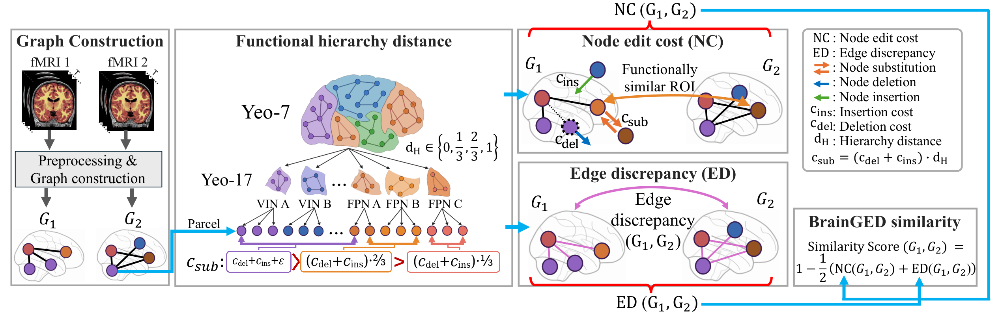

<div align="center">

# BrainGED

### A Hierarchical Community-Aware Similarity Measure for Functional Brain Networks

**Boseong Kim<sup>1</sup> · Debashis Das Chakladar<sup>2</sup> · Haejun Chung<sup>1</sup> · Ikbeom Jang<sup>3</sup>**

<sup>1</sup> Hanyang University, Seoul, Republic of Korea<br>
<sup>2</sup> BITS Pilani, Hyderabad Campus, India<br>
<sup>3</sup> Hankuk University of Foreign Studies, Yongin, Republic of Korea

[](#quick-start)
[](LICENSE)

[Overview](#overview) · [Quick start](#quick-start) · [Usage](#usage) · [Tests](#tests) · [License](#license)

</div>

<p align="center">
  
</p>

<p align="center"><em>BrainGED method overview. The package accepts precomputed, dense signed functional-connectivity matrices.</em></p>

## Overview

BrainGED compares signed, undirected functional brain networks using global
top-*k* sparsification, a hierarchy-aware node edit cost, and an edge
discrepancy in a shared atlas order. It returns a similarity score in
the interval [0, 1].

## Quick start

```bash
git clone https://github.com/labhai/BrainGED.git
cd BrainGED
python -m venv .venv
source .venv/bin/activate
python -m pip install --upgrade pip
python -m pip install -e .
```

## Usage

```python
import numpy as np

from brainged import AtlasMetadata, NodeMetadata, brain_ged

atlas = AtlasMetadata([
    NodeMetadata(1, "L", ("Visual-A", "Visual")),
    NodeMetadata(2, "L", ("Visual-A", "Visual")),
    NodeMetadata(3, "L", ("Visual-B", "Visual")),
    NodeMetadata(4, "R", ("Visual-A", "Visual")),
])

rest = np.array([
    [0.0,  0.8, -0.2, 0.1],
    [0.8,  0.0,  0.6, 0.0],
    [-0.2, 0.6,  0.0, 0.3],
    [0.1,  0.0,  0.3, 0.0],
])
task = np.array([
    [0.0,  0.7, -0.5, 0.1],
    [0.7,  0.0,  0.2, 0.0],
    [-0.5, 0.2,  0.0, 0.4],
    [0.1,  0.0,  0.4, 0.0],
])

result = brain_ged(rest, task, atlas, top_k=2)
print(result.similarity)
```

Inputs are dense, signed, symmetric Pearson-correlation matrices with the same
shape and atlas parcel order. Diagonal entries are ignored. `roi_id` is the
finest hierarchy level; `hierarchy` contains the remaining community labels
from fine to coarse. `top_k` is the number of edges retained by absolute
weight in each matrix.

## Repository structure

| Path | Contents |
| --- | --- |
| `assets/` | BrainGED method overview |
| `src/brainged/` | BrainGED implementation |
| `tests/` | Core method tests |
| `pyproject.toml` | Package metadata and dependencies |
| `LICENSE` | MIT License |

## Tests

```bash
python -m pip install -e ".[test]"
python -m pytest -q
```

## License

This software is distributed under the [MIT License](LICENSE).

## Contact

For code or research inquiries, contact [Boseong Kim](mailto:boseong@hanyang.ac.kr).
